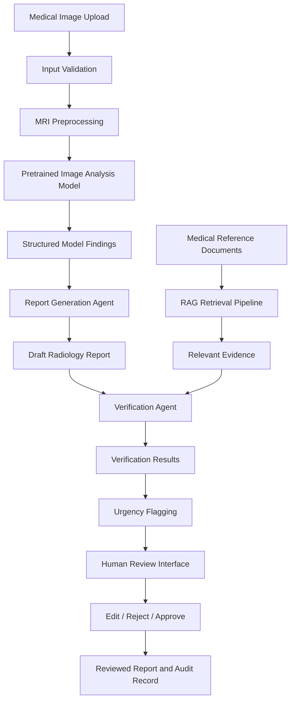

# 🧠 NeuroLens MRI Intelligence
### AI-Powered Medical Image Analysis, Radiology Report Generation & Clinical Decision Support

<p align="center">
  
  
  
  
</p>

<p align="center">
  <b>Turning Medical Imaging into Structured, Evidence-Aware Reports</b>
  <br/>
  An AI-assisted radiology research project combining medical image processing, generative AI, agentic workflows, retrieval-augmented generation (RAG), and human-in-the-loop review.
</p>

---

## 📌 Table of Contents

- [About the Project](#-about-the-project)
- [Problem Statement](#-problem-statement)
- [Project Objectives](#-project-objectives)
- [Key Features](#-key-features)
- [System Architecture](#-system-architecture)
- [How the System Works](#-how-the-system-works)
- [Technology Stack](#-technology-stack)
- [Dataset and Research Resources](#-dataset-and-research-resources)
- [Project Structure](#-project-structure)
- [Installation and Setup](#-installation-and-setup)
- [Running the Application](#-running-the-application)
- [Agentic AI Architecture](#-agentic-ai-architecture)
- [RAG Pipeline](#-retrieval-augmented-generation-rag)
- [Report Generation](#-structured-radiology-report-generation)
- [Evaluation Strategy](#-evaluation-strategy)
- [Research Gap and Contribution](#-research-gap-and-contribution)
- [Limitations and Future Scope](#-limitations-and-future-scope)
- [Team and Acknowledgements](#-team-and-acknowledgements)
- [License](#-license)

---

## 🔍 About the Project

**NeuroLens MRI Intelligence** is a fourth-year engineering major project focused on exploring how artificial intelligence can assist in medical image analysis and radiology report generation.

Radiology workflows involve examining medical images, identifying relevant findings, documenting observations, and preparing structured reports. Generating these reports can be time-consuming, especially when imaging workloads are high.

NeuroLens aims to bring together medical image processing, pretrained vision models, Large Language Models (LLMs), and specialised AI agents into a unified research prototype.

The proposed system accepts medical imaging data, processes it using an appropriate image-analysis model, generates a structured report draft, retrieves relevant medical reference information, checks the draft for unsupported claims, and presents the results for human review.

### 🎯 Project Vision

> To develop an AI-assisted radiology workflow that combines medical image understanding, structured report generation, evidence retrieval, verification, and human oversight in a single system.

The initial implementation focuses on brain MRI volumes. Support for X-ray images and additional imaging modalities is an extension of the project scope.

**Important:** This is a research and educational project, not a clinically validated diagnostic system. AI-generated content must not be treated as a confirmed diagnosis.

---

## ❗ Problem Statement

Traditional radiology reporting requires medical professionals to interpret images and document their findings. Under high workloads, report preparation can become repetitive and time-consuming.

Conventional image-classification systems may predict a category without producing a complete structured report. Similarly, general-purpose language models can generate fluent medical text without necessarily grounding every statement in the supplied image or verified evidence.

NeuroLens investigates the following challenges:

- **Image understanding:** Extracting useful information from MRI images and volumes.
- **Structured reporting:** Converting model outputs into organised radiology-style drafts.
- **Grounded generation:** Connecting generated statements to available model outputs and reference material.
- **Verification:** Detecting unsupported statements, contradictions, and missing evidence.
- **Clinical workflow support:** Highlighting uncertainty and potential review priorities.
- **Human oversight:** Ensuring that generated reports remain drafts until reviewed by a qualified professional.

The goal is to investigate how these components can work together rather than treating image classification, text generation, and clinical review as separate tasks.

---

## 🎯 Project Objectives

1. Develop a medical image preprocessing and visualisation pipeline for supported MRI formats.
2. Integrate an appropriate pretrained medical image-analysis model.
3. Generate structured radiology report drafts from actual model outputs.
4. Design specialised agents for report generation, evidence retrieval, verification, and review prioritisation.
5. Implement Retrieval-Augmented Generation to provide traceable supporting references.
6. Build an interactive web interface for uploading scans and reviewing draft reports.
7. Evaluate report quality, evidence retrieval, verification performance, and system latency.
8. Preserve human oversight and clearly communicate model uncertainty and limitations.

---

## ✨ Key Features

### 🧠 Medical Image Processing
- Support for NIfTI medical imaging files (`.nii` and `.nii.gz`) in the initial MRI viewer.
- Three-dimensional MRI volume loading and slice navigation.
- Image dimensions and voxel-spacing display when available in the image header.
- A modular interface for integrating a pretrained image-analysis model.

### 📝 Structured Report Drafting
- Clinical history section.
- Imaging technique section.
- Findings section.
- Impression section.
- Evidence and limitations fields.
- Draft status and human-review workflow.

The initial report builder can format manually supplied findings. Automated image-to-report generation requires a successfully integrated and tested model.

### 🤖 Agentic AI Workflow — Planned Integration
- Image Analysis Agent.
- Report Generation Agent.
- Verification Agent.
- Medical Knowledge Retrieval Agent.
- Urgency Flagging Agent.
- Workflow Coordinator.

### 📚 Retrieval-Augmented Generation — Planned Integration
- Ingestion of permitted medical reference documents.
- Semantic search over relevant passages.
- Source-aware retrieval.
- Evidence summaries with document attribution.

### 🛡️ Human-in-the-Loop Review
- Clear distinction between draft and approved reports.
- Review, edit, and reject workflow.
- Explicit indication of uncertainty and processing failures.
- Audit logging as a planned backend feature.

### 📊 Evaluation and Research
- Baseline comparison.
- Report-quality evaluation.
- Retrieval metrics.
- Verification error analysis.
- Inference-time and resource measurements.

> **Implementation note:** The features above describe the project scope. Only features that have been implemented and tested in the repository should be presented as completed functionality.

---

## 🏗️ System Architecture

The following diagram illustrates the proposed end-to-end workflow.



### Architecture Explanation

| Component | Responsibility |
|---|---|
| Input Validation | Checks file format, size, and required metadata. |
| Image Preprocessing | Loads the supported image format and applies model-specific preprocessing. |
| Image Analysis Model | Produces image-related predictions or findings. |
| Report Generation Agent | Converts available findings into a structured draft. |
| RAG Pipeline | Retrieves relevant information from permitted reference documents. |
| Verification Agent | Checks draft claims against available evidence and model outputs. |
| Urgency Flagging | Applies documented rules to identify cases requiring further review. |
| Human Review Interface | Allows a qualified reviewer to inspect and edit the draft. |
| Audit Layer | Records processing status, model version, evidence references, and review actions. |

The architecture is modular so that individual components can be tested independently.

---

## 🔄 How the System Works

### Step 1 — Upload a Medical Image

The user selects a supported MRI file through the web interface.

The application validates the file and checks whether the input format is supported.

### Step 2 — Preprocess the Image

The application loads the image using a medical-image library and prepares it according to the selected model's requirements.

Preprocessing may include orientation handling, intensity normalisation, resizing, or sequence selection, depending on the model.

### Step 3 — Analyse the Image

A compatible pretrained medical image-analysis model processes the scan.

The model's actual output is converted into a structured representation that records its predictions, limitations, and provenance.

### Step 4 — Generate a Report Draft

A report-generation component transforms the available findings and permitted clinical context into structured sections.

The language model must not be allowed to invent image findings simply to make the report sound complete.

### Step 5 — Retrieve Supporting Evidence

The RAG component retrieves relevant passages from a curated reference collection.

These passages provide background knowledge and traceable references; they do not independently confirm findings in an individual patient's scan.

### Step 6 — Verify the Draft

The verification component checks whether report statements are supported by the model output, supplied clinical context, or cited evidence.

Unresolved contradictions and unsupported statements should be flagged rather than silently accepted.

### Step 7 — Flag Review Priorities

A documented rule-based component can flag uncertainty, missing inputs, or findings that warrant further review.

Such flags are experimental decision-support outputs and must not be presented as validated emergency detection.

### Step 8 — Human Review

The reviewer examines the original image and the proposed report, makes any required corrections, and records the final review decision.

The system must preserve the distinction between an AI-generated draft and a report approved by a qualified professional.

---

## 🛠️ Technology Stack

The technologies below are grouped by their intended role. Confirm each dependency against the actual code before describing it as an implemented component.

### Core Application

| Technology | Purpose |
|---|---|
| Python | Main programming language for image processing and AI integration. |
| Streamlit | Interactive Python-based interface for image viewing and report drafting. |
| NumPy | Numerical operations and array handling. |
| NiBabel | Loading NIfTI medical imaging files. |
| Matplotlib | Visualising MRI slices. |

### AI and Medical Imaging

| Technology | Intended purpose |
|---|---|
| PyTorch | Running compatible deep-learning models. |
| Hugging Face Transformers | Accessing compatible pretrained transformer models. |
| AutoRG-Brain | Research baseline to investigate for brain MRI report generation. |
| RadGenome-Brain MRI | Research dataset candidate for MRI/report-generation experiments. |
| MONAI | Optional medical-imaging utilities and model-development framework. |

AutoRG-Brain and RadGenome-Brain MRI are research dependencies, not automatically installed components of this application. Their integration depends on dataset access, model checkpoints, dependency compatibility, and successful inference.

### Generative AI and Agentic AI

| Technology | Intended purpose |
|---|---|
| Large Language Models | Generating structured report drafts from available findings. |
| Agent orchestration | Coordinating specialised processing and verification steps. |
| Retrieval-Augmented Generation | Grounding supporting explanations in retrieved reference passages. |
| Rule-based validation | Checking required fields, workflow states, and explicit review conditions. |

### Retrieval and Knowledge Management

| Technology | Intended purpose |
|---|---|
| Sentence Transformers | Generating semantic embeddings for reference passages. |
| FAISS | Searching vectors for semantically relevant documents. |
| PyPDF | Extracting text from supported PDF reference documents. |

### Backend and Development

| Technology | Intended purpose |
|---|---|
| FastAPI | Optional API layer for connecting the frontend to the AI workflow. |
| Pydantic | Validating structured inputs and report outputs. |
| Uvicorn | Serving the FastAPI application. |
| Git and GitHub | Version control, source code management, and documentation. |
| Google Colab | Optional GPU-based experimentation and model inference. |
| VS Code | Local development and debugging. |
| pytest | Automated tests for application components. |

**Tech-stack accuracy:** Streamlit, NiBabel, NumPy, and Matplotlib are the intended core of the initial MRI viewer. Mark FastAPI, PyTorch, FAISS, Transformers, and the agent framework as implemented only after the corresponding modules are present and working. Do not list a cloud provider, database, or deployment platform unless the project actually uses it.

---

## 📂 Dataset and Research Resources

### 1. RadGenome-Brain MRI

**Repository:** [AutoRG-Brain](https://github.com/ljy19970415/AutoRG-Brain)

A research resource to investigate for MRI report generation, multimodal imaging, and associated report annotations.

Potential use:
- Testing pretrained report-generation inference.
- Comparing generated reports against available reference reports.
- Exploring segmentation-assisted report generation.

Access requirements, data preparation, model checkpoints, and licensing should be checked in the official repository.

### 2. BraTS Brain MRI

**Dataset access:** [BraTS 2020](https://www.med.upenn.edu/cbica/brats2020/registration.html)

A brain MRI research dataset with multimodal imaging and tumour-segmentation labels.

Potential use:
- MRI volume loading and visualisation.
- Segmentation experiments.
- Tumour-analysis baselines.

**Important:** BraTS segmentation labels are not equivalent to original radiologist-authored narrative reports. Use a report-paired dataset for report-generation evaluation.

### Data Management

- Follow the dataset's licence and access restrictions.
- Never upload restricted medical images or patient-identifiable data to a public repository.
- Keep model checkpoints and large datasets outside Git unless redistribution is explicitly permitted.
- Split data by patient where applicable to reduce leakage between training and testing.
- Document the dataset version, preprocessing procedure, and evaluation split.

---

## 📁 Project Structure

The following is a recommended structure for the complete implementation. Adjust it to match the actual repository.

```text
neurolens-mri-intelligence/
│
├── app.py
├── requirements.txt
├── README.md
├── .gitignore
├── LICENSE
│
├── backend/
│   ├── main.py
│   ├── schemas.py
│   └── config.py
│
├── src/
│   ├── image_preprocessing.py
│   ├── image_analysis.py
│   ├── report_generator.py
│   ├── agents.py
│   ├── rag.py
│   ├── urgency.py
│   └── evaluation.py
│
├── knowledge_base/
│   └── README.md
│
├── notebooks/
│   └── dataset_exploration.ipynb
│
├── tests/
│   ├── test_preprocessing.py
│   ├── test_report_schema.py
│   └── test_safety.py
│
└── outputs/
    └── README.md
```

### What Each File Does

- `app.py`: Streamlit entry point and user interface.
- `backend/main.py`: Optional FastAPI endpoints.
- `backend/schemas.py`: Structured definitions for image findings and reports.
- `src/image_preprocessing.py`: Image loading, validation, and preprocessing.
- `src/image_analysis.py`: Adapter connecting the selected medical image model.
- `src/report_generator.py`: Converts available findings into structured report drafts.
- `src/agents.py`: Coordinates report generation and verification components.
- `src/rag.py`: Document ingestion, embeddings, retrieval, and source attribution.
- `src/urgency.py`: Implements documented review-priority rules.
- `src/evaluation.py`: Computes metrics and saves experimental results.
- `tests/`: Automated tests for supported inputs, report schemas, and safety rules.
- `knowledge_base/`: Instructions for preparing permitted reference documents.
- `notebooks/`: Dataset inspection and reproducible experiments.

---

## 🚀 Installation and Setup

### Prerequisites

- Python 3.10 or another version supported by your selected dependencies.
- Git.
- VS Code or another Python editor.
- Sufficient disk space for MRI data and model checkpoints.
- Google Colab GPU access or compatible local hardware if required by the selected model.

### Step 1 — Clone the Repository

```bash
git clone https://github.com/milind007K/neurolens-mri-intelligence.git
cd neurolens-mri-intelligence
```

### Step 2 — Create a Virtual Environment

**Windows PowerShell:**

```powershell
python -m venv .venv
.venv\Scripts\Activate.ps1
```

If PowerShell blocks activation, use Command Prompt:

```bat
.venv\Scripts\activate.bat
```

**Linux/macOS:**

```bash
python3 -m venv .venv
source .venv/bin/activate
```

### Step 3 — Install Dependencies

```bash
python -m pip install --upgrade pip
pip install -r requirements.txt
```

Use the dependency versions documented for the actual model repository when integrating AutoRG-Brain. Avoid blindly combining incompatible PyTorch, CUDA, and medical-imaging dependencies.

### Step 4 — Run the Application

For the Streamlit application:

```bash
streamlit run app.py
```

Open the local URL printed in the terminal, usually:

```text
http://localhost:8501
```

If the repository uses a different entry point, follow its actual configuration.

### Step 5 — Verify the Installation

Confirm that:

- The interface opens.
- A supported MRI volume loads successfully.
- Slice navigation works.
- The structured report form produces a draft.
- Any enabled AI model runs successfully on a permitted test sample.
- Failures are reported clearly rather than producing fabricated findings.

The initial viewer can run without a GPU. Pretrained medical image inference may require additional dependencies, checkpoints, and GPU memory.

---

## 🧩 Agentic AI Architecture

The proposed agentic workflow divides the reporting process into specialised responsibilities.

### 1. Image Analysis Agent

Receives the MRI input and calls the configured medical image-analysis model.

**Output:** Model findings, modality information, limitations, and provenance.

The agent must not substitute manually entered findings for actual model predictions without identifying their source.

### 2. Report Generation Agent

Uses available findings and permitted clinical context to create a structured draft.

**Output:** Clinical history, technique, findings, impression, and relevant limitations.

The agent must preserve uncertainty and avoid unsupported statements.

### 3. Verification Agent

Checks the draft against the source findings and supporting evidence.

Possible checks:
- Unsupported findings.
- Contradictory statements.
- Missing required sections.
- Inconsistent modality references.
- Missing evidence citations.

Its output is a verification result, not a guarantee of clinical correctness.

### 4. Medical Knowledge Retrieval Agent

Searches the reference collection for relevant background information.

**Output:** Retrieved passages, source metadata, and a grounded summary.

It should not claim that general medical literature confirms a patient-specific diagnosis.

### 5. Urgency Flagging Agent

Applies predefined, documented rules to identify cases requiring further review.

Possible internal states include:

- `REVIEW_REQUIRED`
- `PRIORITY_REVIEW`
- `INDETERMINATE`

These are workflow flags, not validated emergency diagnoses. Failed inference and missing inputs must be handled explicitly.

### 6. Workflow Coordinator

Executes the agents in the correct order, handles errors, and assembles the result.

The coordinator must prevent an unverified draft from being represented as an approved report.

---

## 📚 Retrieval-Augmented Generation (RAG)

RAG combines a language model with a retrieval system that searches an external collection of documents before generating an answer.

### RAG Workflow

```text
Permitted Medical Reference Documents
                 |
                 v
           Text Extraction
                 |
                 v
          Chunking + Metadata
                 |
                 v
             Embeddings
                 |
                 v
          Vector Index (FAISS)
                 |
                 v
        Retrieve Relevant Passages
                 |
                 v
     Grounded Summary with Citations
```

### Why RAG Is Useful

A language model's internal knowledge may be outdated, incomplete, or difficult to trace to a source. RAG allows the application to retrieve relevant passages and show which documents support the generated explanation.

The reference collection should preserve document titles, dates, sections, and URLs or DOIs where available.

### Proposed Evaluation

Use a set of questions with known relevant passages and measure Recall@3:

\[
\text{Recall@3} =
\frac{\text{Questions with relevant evidence in top 3}}
{\text{Total questions}}
\]

This measures retrieval performance, not diagnostic accuracy.

---

## 📄 Structured Radiology Report Generation

The report generator should produce a consistent structure.

| Section | Description |
|---|---|
| Clinical History | Clinical context supplied by an authorised user. |
| Technique | Imaging sequence and technique information supported by the available data. |
| Findings | Observations generated by the model and requiring review. |
| Impression | Concise summary of supported findings, with uncertainty preserved. |
| Evidence | Traceable source passages where relevant. |
| Limitations | Missing data, uncertainty, and model limitations. |
| Review Status | Whether the draft is awaiting review or has been reviewed. |

### Example Report Structure

The following is a template illustration, not a real patient report or an AI prediction.

```text
NEUROLENS MRI INTELLIGENCE
DRAFT RADIOLOGY REPORT

Clinical History:
Not provided.

Technique:
Not provided.

Findings:
Awaiting output from the connected image-analysis model
and review by a qualified professional.

Impression:
Not generated.

Evidence:
No evidence attached.

Limitations:
Image analysis and report verification must be completed.

Review Status:
UNREVIEWED — NOT FOR CLINICAL USE
```

The system should never populate a missing finding with a normal result simply because no prediction was returned.

---

## 📊 Evaluation Strategy

The project should evaluate each component independently as well as the complete workflow.

| Component | Suggested evaluation |
|---|---|
| MRI preprocessing | Successful loading rate, invalid-file handling, modality checks. |
| Classification, if implemented | Precision, recall, F1-score, and confusion matrix. |
| Segmentation, if implemented | Dice coefficient and Intersection over Union. |
| Report generation | BLEU, ROUGE-L, and findings-level clinical assessment. |
| Verification agent | Unsupported claims detected, false alarms, and missed errors. |
| RAG | Recall@3 or another appropriate retrieval metric. |
| Urgency flagging | Sensitivity, specificity, and confusion matrix when suitable reference labels exist. |
| Application performance | Inference latency, memory use, and failure rate. |
| Human review | Review time, edit rate, and rejection rate when measured. |

### Baseline vs. Proposed System

**Baseline:** Image model followed by report generation.

**Proposed workflow:** Image model, report generation, RAG, verification, and urgency flagging.

Run both configurations on the same held-out cases. Record the model versions, prompts, preprocessing steps, and evaluation split.

Text similarity alone does not establish clinical correctness. Evaluate important omissions, contradictions, and unsupported claims wherever suitable reference labels or qualified review are available.

**Do not invent accuracy, F1-score, latency, or clinical-validation figures.** Report only results measured in your experiments.

---

## 🔬 Research Gap and Contribution

The proposed research focuses on the integration and evaluation of several components within one reporting workflow.

### Research Challenges

1. Image-to-report generation may produce statements that are difficult to trace to image-level evidence.
2. Generated text can contain unsupported or contradictory claims.
3. Retrieved medical knowledge can be confused with evidence about an individual scan.
4. Urgency-related outputs require explicit uncertainty handling and appropriate reference labels.
5. Human review must remain part of the workflow rather than being an optional afterthought.

### Proposed Contribution

NeuroLens MRI Intelligence aims to investigate a modular, evidence-aware reporting pipeline that combines image analysis, structured text generation, retrieval, verification, review-priority flags, and human oversight.

Its contribution should be demonstrated through baseline comparisons, ablation experiments, error analysis, and reproducible evaluation—not merely by showing that multiple AI agents are connected.

This is a proposed research contribution, not a claim that no existing system combines similar methods.

---

## 🔮 Future Scope

Potential extensions include:

- **X-ray integration:** Add a compatible X-ray model and modality-specific report workflow.
- **Advanced image analysis:** Explore segmentation, localisation, and visual explanation methods.
- **Improved verification:** Add structured claim extraction and stronger evidence-consistency checks.
- **Expanded RAG:** Support additional permitted medical reference sources with source-aware retrieval.
- **Workflow tracing:** Record model versions, execution stages, errors, and review actions.
- **Backend integration:** Separate the user interface and model workflow through FastAPI.
- **Reproducible deployment:** Add dependency pinning, automated tests, and containerisation where appropriate.
- **Research evaluation:** Compare different report-generation approaches and investigate how each agent affects the final output.

All extensions require implementation and testing before being described as completed features.

---

## ⚠️ Limitations and Responsible Use

NeuroLens MRI Intelligence is an academic research prototype.

- It is not a certified medical device.
- It must not replace a radiologist or other qualified healthcare professional.
- Generated findings and urgency flags may be incorrect or incomplete.
- General reference documents cannot confirm a patient-specific diagnosis.
- Performance may vary with modality, image quality, acquisition protocol, and dataset distribution.
- The project requires appropriate privacy protection, dataset permissions, and secure handling of medical information.
- Human review and explicit uncertainty handling are essential before any report is considered final.

The application must not autonomously prescribe medication or present unvalidated recommendations as established clinical decisions.

---

## 👥 Team and Acknowledgements

**Project:** NeuroLens MRI Intelligence

**Academic context:** Fourth-Year Engineering Major Project, Artificial Intelligence and Machine Learning.

**Repository:** [milind007K/neurolens-mri-intelligence](https://github.com/milind007K/neurolens-mri-intelligence)

The project draws on open research in medical imaging, deep learning, generative AI, retrieval-augmented generation, and radiology report generation.

Acknowledgements should be added for the actual dataset authors, model developers, research repositories, and libraries used in the implementation.

---

## 📜 License

Choose and add a licence that is appropriate for your own code and the terms of the third-party datasets and model checkpoints you use. A licence for your source code does not automatically grant permission to redistribute external medical data or pretrained weights.

---

## ⭐ Final Note

NeuroLens MRI Intelligence explores how medical image analysis and generative AI can be combined with evidence retrieval, verification, and human oversight to support structured radiology reporting.

The objective is not simply to generate medical text. It is to build and evaluate
